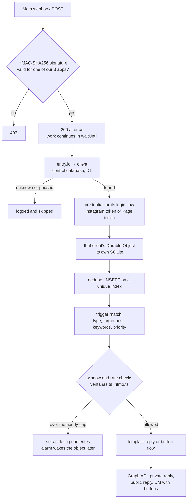

# ChatyChat

Answers Instagram and Messenger comments and direct messages on behalf of many
small businesses, from a single installation. A business connects its account
once; from then on, whoever comments on a post or writes in gets an answer.

Two pieces:

- **`src/`**, a Cloudflare Worker that receives Meta's webhooks, works out
  which business each event belongs to, and replies inside Meta's rules.
- **`web/`**, the panel where a business signs up, connects its account and
  reads what was answered in its name. Next.js on Cloudflare via OpenNext.

In production on Cloudflare since September 2026. 75 unit tests (`npm test`)
plus an end-to-end battery against a local Worker (`npm run probar`).

## Why it exists

The established tools in this space charge per contact. A business pays more
every month its audience grows, which means the bill rises exactly when the
tool is doing its job. For a small shop that is a pricing model it outgrows.

The work itself is cheap. Answering a comment is: receive a POST, check a
signature, read two small tables, send a POST, write two rows. No computation,
just waiting on the network twice. That is what Workers are built for, and it
is why this can be priced per business rather than per contact: the
infrastructure is billed per account, not per database or per client, and the
paid Workers plan starts at $5 a month.

Measured on the one account with real history (17,787 stored events, most of
them imported comments): **8 MB** of storage.

## Architecture



**Where each client's data lives.** Two kinds of storage, and the rule for
which is which: *if deleting a client must delete it, it goes in the client's
own storage.*

| Storage | What is in it |
|---|---|
| **Control database** (one D1) | who the clients are, their Meta tokens, their login flow, health, panel accounts, data-deletion requests, the admin access log |
| **One Durable Object per client**, each with its private SQLite | automations, triggers, flow boxes and buttons, comments and messages received, contacts, scheduled sends, the hourly call counter |

The conversations of a business's customers never share a database with
another business. A query cannot leak them across clients because the object
can only reach its own storage.

## Decisions, and why

### Data isolation: one store per client

The data is private conversations of people who never heard of us. "Every
business has its own database and nothing can cross them" is a much stronger
answer, to Meta's annual data-protection assessment or to a client, than
"every query filters by client id".

It started as **one D1 database per client**, and hit a wall on day one: a
Worker cannot open an arbitrary D1 database at runtime. Bindings are declared
in `wrangler.jsonc` and resolved at deploy time, so every new client meant a
redeploy. The D1 REST API looks like the way around it, but it shares the
account-wide limit of 1,200 requests per five minutes, which is about one
webhook per second for the whole platform.

So the first version obeyed one rule: **no function that queries a client's
data knows where that data comes from**; it receives the database as a
parameter, and exactly one file resolved it. That made the move to **a Durable
Object per client** a change of one resolver instead of a rewrite. A Durable
Object is created by name (`idFromName(clientKey)`), so a business that signs
up exists instantly, with no deploy. It also brought alarms, which solved the
next problem for free.

The control database stayed in D1 on purpose: it is one database, shared by
the platform, and D1 can be queried from a terminal, which is worth a lot when
diagnosing.

### Meta's 24-hour window, and the three doors

Instagram has no single "send a message". It has three ways to answer, each
with its own deadline, and `src/ventanas.ts` is the **only** place allowed to
decide whether a send is permitted:

| Door | Deadline | Buttons |
|---|---|---|
| Private reply to a comment | 7 days from the comment, one per comment | no |
| Message to the inbox | 24 hours from the person's last **message** | up to 3 |
| Public reply under the comment | none | n/a |

A comment does not open the 24-hour window; only a message does, and a button
click counts as one. That shapes every flow: someone who comments gets a plain
text first, and buttons appear only if they answer. The window is checked
**before every box** of a chained flow, not once at the start, because a long
chain can cross the edge. The code closes it ten minutes early, so a send that
would arrive late is never attempted.

Breaking these rules does not return a technical error. It costs the business
its Instagram messaging, which is the channel it sells through.

### The public reply never expires

The third door has no deadline: a comment from two years ago can be answered
publicly today. So a business's old unanswered comments are not history, they
are pending work the product can do, and anyone visiting the post sees it.
That is why the history import is designed to bring in **all** of an account's
comments, newest post first, in batches. Its state lives in the client's own
schema (`importacion`, `importacion_medios`), and the Durable Object's alarm is
what paces it, so it never needs a long-running process.

### Rate control

Meta allows 750 calls per hour per account, and answering a comment costs two
(the private reply and the public one). A post that goes viral exhausts that in
minutes, and from then on every send fails, on exactly the day the business is
doing well. `src/ritmo.ts` counts calls, not replies, and stops at 700: the
limit belongs to the whole account and the business may run other tools on it.

What does not fit is **set aside, not dropped**. A private reply has seven
days, so the next hour is fine. It goes to `pendientes` and the client's
Durable Object sets an alarm for the exact time of its next pending item. A
client with nothing pending costs nothing; a follow-up scheduled 23 hours ahead
fires at its time, not at the next cron tick.

Inside a Durable Object, `sql.exec()` is synchronous, so reading the counter
and incrementing it is a single step with no `await` between them for another
request to slip through.

### Privacy and the data deletion Meta requires

Meta requires two callback URLs before reviewing an app, and both arrive as a
`signed_request` that is verified before anything is believed (`src/privacidad.ts`):

- **Deauthorization.** The client is marked as disconnected immediately,
  instead of being discovered by the next daily health pass while the bot
  fails send after send in their name.
- **Data deletion.** Returns the `{ url, confirmation_code }` Meta expects. The
  code is random and carries no user id, because it ends up in a public URL.
  The request is stored in the **control** database, not the client's, because
  it has to survive the deletion it asks for. The alert email carries the code,
  not the person's id, so the email provider never becomes a processor of Meta
  user data.

Removing a client and destroying its data are two separate acts. Access to a
client's data through the maintenance door (`src/admin.ts`) requires a
personal key, stored as a SHA-256 hash and revocable without a deploy, and
every request, accepted or rejected, leaves a row in an access log. The module
has a single exit point so that no new branch can return without being logged.

### Two Meta login flows

There is no single "Instagram API". An account that lives only on Instagram
must use Instagram Login; an account linked to a Facebook Page must use
Facebook Login, and a token from the wrong one authorises fine and then fails
every call with `code 100: Unsupported request`. Which flow a client needs
cannot be known before they authorise, so the connect link is always
`/conectar/<key>`: the Worker tries Instagram Login, and if the token cannot
resolve the account it records the flow and redirects to Facebook Login on the
spot. That means two Meta apps and three signing secrets, and every signature
check tries all three (`src/index.ts`).

`Credencial` in `src/enviar.ts` is a discriminated union, so a Facebook send
without its Page id does not compile.

### The AI model, chosen by cost

Replies today come from each automation's own text. The AI drafting layer is
designed around a decision taken with measured numbers, not estimates:

- **`gpt-6-luna`**, at $0.10 / $0.50 per million input / output tokens, half
  the price of the model first considered. Measured against the real API on
  four real comments with a shop's instructions and knowledge base: about
  **$0.00007 per reply**.
- **A monthly spending cap per client, in euros**, because every client runs
  on the same key and the bill arrives in euros.
- **Stable prompt first, comment last**, so the provider's prompt cache (90%
  cheaper input) hits on every comment from the same business.
- **Nothing generated is published unchecked.** In testing, one call in four
  came back empty after spending its whole token budget, and the same input
  succeeded on retry. Empty means one retry, then the automation's fixed text.
  That is why the fixed text is the safety net and has to work on its own.

The schema is ready for it: each reply stores its origin (`fija` or `ia`) and
the exact token counts. Tokens are stored rather than euros because tokens are
a fact and prices change.

## Running it locally

Requires Node 22.18 or later.

```bash
npm install
cp .dev.vars.example .dev.vars   # local-only secrets
npm run preparar-pruebas         # local control database with two fake clients
npm run dev                      # the Worker on http://127.0.0.1:8787
npm run probar                   # in another terminal: the end-to-end battery
```

The battery drives the Worker through `herramientas/simular.mjs`, which sends
fake but correctly signed webhooks:

```bash
node herramientas/simular.mjs comentario --texto "info"
node herramientas/simular.mjs comentario --repetir 3     # same comment id, three times
node herramientas/simular.mjs mensaje --texto "precio"
node herramientas/simular.mjs historia --texto "si"
node herramientas/simular.mjs comentario --firma-mala    # must be rejected
```

Only the input is fake. Past that, the Worker acts for real, which is why the
test clients carry invented tokens: every send fails at Meta with a 400, and
that is the expected result. For the same reason the simulator refuses any
non-local URL unless told twice (`--si-quiero-tocar-produccion`).

Unit tests and type checks need no Worker and no network:

```bash
npm test             # node --test over test/*.test.ts, real schema on node:sqlite
npm run typecheck
```

The panel:

```bash
cd web && npm install && npm run cf-typegen && npm run dev
```

`wrangler.jsonc` and `web/wrangler.jsonc` use placeholders (`YOUR_D1_DATABASE_ID`,
`webhook.example.com`); the `desarrollo` environment used by `npm run dev`
needs none of them.

## Layout

```
src/index.ts             webhook entry: signature, routing by account, cron
src/base.ts              the control database, and the credential per login flow
src/cliente.ts           the Durable Object: one per business, schema migrations, alarms
src/esquema-cliente.ts   a client's schema, as append-only steps
src/atender.ts           what happens to a comment, message, story reply or click
src/disparadores.ts      which automation answers
src/flujos.ts            flow boxes and buttons
src/ventanas.ts          Meta's rules: deadlines, lengths, buttons
src/ritmo.ts             the hourly call budget
src/pendientes.ts        sends set aside or scheduled for later
src/eventos.ts           deduplication and the 24-hour window source
src/enviar.ts            the only code that talks to the Graph API
src/conectar*.ts         OAuth for both Meta login flows, with a signed state
src/salud.ts             daily token renewal and subscription health
src/privacidad.ts        deauthorization and data-deletion callbacks
src/admin.ts             the maintenance door, per-person keys and access log
base/control.sql         the control database schema
herramientas/            local simulator, end-to-end battery, local setup
test/                    unit tests
web/                     the panel
```

## A note on the code

Comments and identifiers are in Spanish, the language the product is built and
run in. They explain why each decision was made, often with the date and the
failure that prompted it.

## Licence

All rights reserved. The source is shown for portfolio review; see `LICENSE`.
